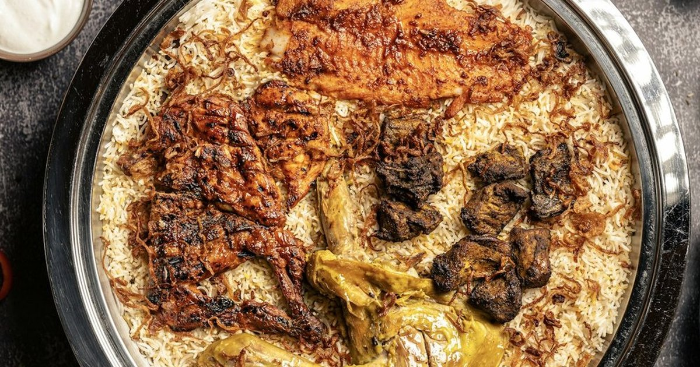

# Arabic Mandi

A one-page website for a Yemeni mandi restaurant. I built it as a demo to show restaurant owners what their own site could look like.

Live: https://arabic-mandi.pages.dev



## What's on the page

It scrolls top to bottom in seven parts:

1. A hero with opening hours and a running "smoking for" timer for the pit
2. A short section on how mandi is made: rubbed overnight with hawaij, sealed over coals, served on one platter
3. A photo gallery, filterable by food, ambience and cooking
4. A platter builder where you pick the meat, the size and extras, and the total updates as you go
5. The full menu with quarter, half and full portions, plus a veg / non-veg filter
6. A table booking form with an option for majlis floor seating
7. Hours, online ordering and directions

The menu, cart and platter builder all work in the browser. The booking form doesn't send anything yet, and the prices are placeholders. For a real restaurant I'd wire the form to WhatsApp or email and put in their actual menu.

## Files

```
site/                       the site that's deployed
  index.html
  img/                      food and interior photos (webp)
  og.jpg                    image shown when the link is shared
  _headers                  cache settings for Cloudflare Pages
arabic-mandi-website.html   the whole site in one file, images included (about 13 MB)
```

The single file is handy for sending the demo to someone over WhatsApp or email without a link.

## Running it locally

Serve the `site` folder with any static server:

```
npx serve site
```

## Deploying

It's hosted on Cloudflare Pages:

```
npx wrangler pages deploy site --project-name arabic-mandi
```

## Want one for your restaurant?

I'm Manikanta, and I build websites for restaurants. If you run a restaurant and want something like this for it, write to me at manikanta.webdesigner@gmail.com.
